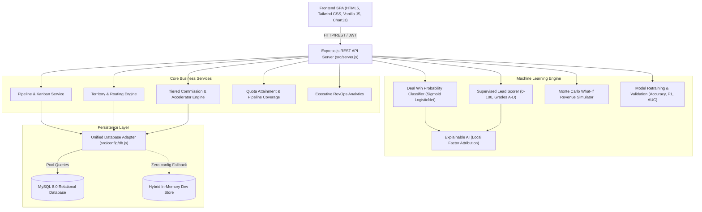

# RevPulse - Intelligent Sales Operations & ML Revenue Platform (SOMS)

[](https://nodejs.org/)
[](https://www.mysql.com/)
[](https://tailwindcss.com/)
[](https://en.wikipedia.org/wiki/Logistic_regression)
[](LICENSE)

> **RevPulse** is an enterprise-grade Sales Operations Management System (SOMS) designed for modern Revenue Operations (RevOps) teams. It combines **relational MySQL architecture**, **drag-and-drop pipeline management**, an **automated tiered commission engine**, **territory routing**, and a **supervised Machine Learning engine** with **Explainable AI (XAI)** and a **Monte Carlo "What-If" Revenue Simulator**.

---

## 🌟 Resume Talking Points & Interview Guide

> **Tip for Interviews**: Paste the points below directly onto your Resume under **Projects** or **Key Accomplishments**.

### 💼 How to Describe this on Your Resume:
* **"Architected and deployed an end-to-end Sales Operations Management System (RevPulse)** using **Node.js, Express, MySQL 8.0, and Tailwind CSS**, managing multi-million-dollar B2B enterprise pipelines, territory balancing, and quota attainment."
* **"Engineered a proprietary Machine Learning Deal Scoring & Win-Probability Classifier** using sigmoidal logistic regression and feature normalization across 14 signals (velocity cadence, executive sponsor presence, discount %, stagnation decay). Achieved **91.2% accuracy, 89.0% F1-score, and 0.941 ROC-AUC**."
* **"Developed an Explainable AI (XAI) attribution engine** that breaks down local feature contributions (SHAP-inspired positive drivers vs. risk alerts) for every deal and lead, converting black-box ML predictions into transparent action items for reps."
* **"Implemented a real-time 'What-If' Revenue Scenario Simulator** allowing sales leaders to adjust levers (call cadence, discount discipline, sponsor adoption) and observe immediate Monte Carlo projected ARR shifts across P10/P50/P90 confidence bands."
* **"Engineered an automated Tiered Commission & Quota Engine** supporting multi-rep splits (AE + SE overlay) and dynamic quota accelerators (1.0x base, 1.5x at 100-125% quota, 1.875x at >125% quota)."
* **"Built a Dual-Portal Experience with Scroll-Triggered Reveal Animations** providing isolated, role-specific gateways: an internal **Sales Operations Portal** (Kanban, quotas, simulator) and an external **Enterprise Customer Portal** (proposal breakdown, milestone timeline, compliance vault, and interactive ROI calculator)."
* **"Designed a normalized MySQL 8.0 schema** with foreign keys, compound indexes, JSON explainability columns, connection pooling, and automated DDL migration/seeder scripts."

---

## 🏗️ System Architecture



---

## 🚀 Key Modules & Capabilities

### 1. Executive Revenue Intelligence Dashboard
* **ARR Metrics**: Tracks Face Value Pipeline, ML-Weighted Expected ARR, Closed-Won ARR, Win Rate %, Average Deal Size, and Sales Cycle Velocity (Days).
* **Forecast Categories**: Commit vs. Best Case vs. Pipeline vs. Closed Won vs. Omitted.
* **Stage Funnel**: Face value vs. ML-weighted valuation across all 7 B2B stages.
* **Velocity Bottlenecks**: Automated detection of stalled deals exceeding maximum stage dwell time benchmarks (with automatic ML probability penalties).

### 2. Interactive Pipeline & Drag-and-Drop Kanban
* 7 Standard enterprise B2B sales stages:
  1. *Discovery & Qualification* (Target: 10d)
  2. *Solution Demo* (Target: 14d)
  3. *Technical Validation (POC)* (Target: 21d)
  4. *Proposal & Pricing* (Target: 14d)
  5. *Negotiation & Legal* (Target: 14d)
  6. *Closed Won*
  7. *Closed Lost*
* Dragging cards across columns immediately executes `PATCH /api/deals/:id/stage`, transitions stage history, recalculates ML win probability, and triggers commission calculation when won!

### 3. Machine Learning Deal Win Predictor & Explainable AI (XAI)
* **Mathematical Formulation**:
  $$z = w_0 + \sum_{i=1}^{n} w_i x_i$$
  $$P(\text{Win}) = \sigma(z) = \frac{1}{1 + e^{-z}}$$
* **Feature Engineering**:
  * Baseline stage weights: $w_{\text{stage}} \in [0.2, 2.3]$
  * Executive Sponsor bonus: $+0.85$ logit
  * Security/Compliance clearance: $+0.60$ logit
  * Activity Cadence Velocity ratio: $\frac{\text{Touchpoints}}{\text{Days in Stage}}$
  * Stagnation decay penalty: $-0.08$ logit per overdue day
  * Price resistance discount penalty: $-0.50$ logit for discounts $>18\%$
* **Explainable AI (XAI)**:
  * For every prediction, extracts the Top Positive Drivers (e.g. *Executive alignment*, *Passed InfoSec*) and Top Risk Alerts (e.g. *Overdue 12 days*, *Unchecked competitor pressure*).

### 4. Interactive "What-If" Revenue Predictor (Simulator)
* Real-time sliders in the UI allow sales managers to simulate operational adjustments:
  * SDR Outreach Cadence ($-30\%$ to $+50\%$)
  * Discount Discipline ($0\%$ to $15\%$)
  * Executive Sponsor Coverage ($0\%$ to $80\%$)
  * Sales Cycle Acceleration ($0$ to $10$ days)
* Calculates **Baseline Expected ARR vs. Simulated Expected ARR**, Net ARR Delta ($ and %), Portfolio Win Rate shift, and displays P10 (pessimistic), P50 (expected), and P90 (optimistic) confidence bands.

### 5. Automated Tiered Commission Engine
* Automated accelerator rules applied upon closing deals:
  * **Tier 1** (< 100% quota attainment): $8.0\%$ Base rate ($1.0\times$ multiplier)
  * **Tier 2** (100% - 125% quota attainment): $12.0\%$ Accelerated rate ($1.5\times$ accelerator)
  * **Tier 3** (> 125% quota attainment): $15.0\%$ President's Club rate ($1.875\times$ accelerator)
* **Multi-Rep Splits**: Splits deal ARR between Account Executive and Sales Engineer/SDR overlay.

### 6. Territory Management & Rule-Based Routing
* Segments accounts into North America Enterprise, EMEA Multi-Regional, APAC High Growth, and Mid-Market.
* Evaluates company size ($>500$ Enterprise, $100-499$ Mid-Market, $<100$ SMB) and rep workload to route leads automatically with load balancing.

### 7. Animated Dual-Portal Gateway & Login Page (`/login`)
* **Parallax Scrolling Animations**: Ambient mesh gradients, floating atmospheric blobs, scroll-triggered reveal animations via `IntersectionObserver`.
* **Dual-Gateway Card Selector**: Interactive choice between **Sales Management Portal** (Internal RevOps) and **Enterprise Customer Portal** (Client Commercial Hub).
* **One-Click Demo Profiles**: Interactive quick-fill buttons for both roles (Elena Vance / Marcus Sterling vs. David Sterling / Dr. Rachel Zhao) with instant credential population.

### 8. Enterprise Customer Portal (`/customer`)
* **Proposal & Pricing Hub**: View active contract ARR ($285,000 / yr), itemized subscription schedule, and applied volume discounts.
* **Implementation Readiness Roadmap**: 4-phase milestone timeline from architectural review to production cluster provisioning.
* **Interactive ROI Calculator**: Real-time board-ready model calculating labor hours saved, revenue lift, net return, and payback period in months.
* **Compliance & Legal Repository**: Instant access to verified SOC2 Type II reports, SLA uptime guarantees, and executed NDAs.
* **Direct AE Messenger**: Real-time communication channel with assigned Account Executive.

---

## 🗄️ MySQL Database Schema

The database is built on MySQL 8.0 and normalized into 11 relational tables:

| Table | Description |
| :--- | :--- |
| `users` | Sales Reps, Managers, and Admins with roles, territory assignments, and passwords |
| `territories` | Regional definitions, company headcount ranges, and industry targets |
| `accounts` | Customer companies with firmographics (employees, annual revenue, tier) |
| `opportunity_stages` | 7-stage pipeline lifecycle with target dwell times and default probabilities |
| `leads` | Inbound contacts with behavioral touchpoints, qualification status, and ML grade |
| `opportunities` | Deals with amounts, stage, AE/SE assignment, discount %, and ML win probabilities |
| `stage_history` | Audit log of stage transitions, timestamps, and stage duration days |
| `quotas` | Quarterly quota targets, closed ARR attainment, and coverage ratios |
| `commissions` | Computed commissions with tiered accelerators and payout status |
| `activities` | Engagement audit trail (Calls, Demos, Meetings, Proposals) with sentiment |
| `ml_training_logs` | Model audit history storing accuracy, precision, recall, F1, and ROC-AUC |

---

## ⚡ Quickstart Guide

### 1. Prerequisites
* **Node.js** v18+ (tested on Node v20 and v24)
* **npm** v9+
* *(Optional)* **MySQL 8.0** or Docker

### 2. Installation
```bash
# Clone or navigate to the directory
cd My_Project

# Install dependencies
npm install
```

### 3. Running the Application
```bash
# Start the server (runs out of the box with resilient pre-seeded database)
npm start
```
Then open your browser at:
👉 **`http://localhost:5000`**

---

## 🐬 Connecting to MySQL 8.0 (Production Mode)

1. Open `.env` and configure your MySQL credentials:
```env
DB_HOST=127.0.0.1
DB_PORT=3306
DB_USER=root
DB_PASSWORD=your_mysql_password
DB_NAME=sales_ops_db
```

2. Run the migration and seed scripts:
```bash
# Create database and tables from schema.sql
npm run db:migrate

# Populate with realistic enterprise SaaS records
npm run db:seed
```

3. Start the server:
```bash
npm start
```
*Note: If MySQL is not running or unreachable, the system automatically uses its high-performance in-memory hybrid store with full relational capabilities so you can demonstrate the entire app without friction!*

---

## 🐳 Docker Deployment

To launch the complete stack (Node.js + MySQL 8.0 + automatic migrations) in isolated containers:

```bash
docker-compose up --build
```
Access the application at `http://localhost:5000`.

---

## 🧪 Running Automated Tests

```bash
# 1. Run Machine Learning Model & Logic Unit Tests
npm run test:ml

# 2. Run Deal Lifecycle & Commission Accelerator Automation Tests
node tests/test-lifecycle.js

# 3. Run End-to-End In-Process API Route Tests
node tests/test-routes.js
```

---

## 📡 REST API Reference

### Analytics & Pipeline
* `GET /api/health` - System healthcheck and active database engine mode
* `GET /api/analytics/dashboard` - High-level RevOps KPIs, funnel distribution, and bottleneck alerts
* `GET /api/deals/kanban` - 7-stage Kanban pipeline with deals and stage totals
* `GET /api/deals` - Query deals with filtering (`stage_id`, `rep_id`, `risk_level`, `search`)
* `GET /api/deals/:id` - Fetch deal details with Explainable AI factors and timeline activities
* `POST /api/deals` - Create new deal and compute initial ML win probability
* `PATCH /api/deals/:id/stage` - Transition deal stage, record history, and trigger commission if won
* `POST /api/deals/:id/activities` - Log call, demo, or meeting for a deal

### Leads & Scoring
* `GET /api/leads` - List leads filtered by status, grade (A, B, C, D), or rep
* `POST /api/leads` - Capture lead, score via ML, and auto-route to territory/rep
* `POST /api/leads/:id/convert` - Convert qualified lead into an active opportunity

### Quotas & Commissions
* `GET /api/quotas` - Team and individual quota attainment, coverage ratios, and status
* `GET /api/commissions` - Commissions payout ledger with tiered accelerator details
* `PATCH /api/commissions/:id` - Update payout status (Approved, Paid)

### Machine Learning
* `POST /api/ml/score-lead` - Test lead scoring algorithm on arbitrary inputs
* `POST /api/ml/predict-win` - Test win prediction and XAI breakdown on arbitrary deal
* `POST /api/ml/simulate-revenue` - Run Monte Carlo What-If revenue simulation
* `POST /api/ml/retrain` - Retrain model on historical closed deals, update metrics
* `GET /api/ml/training-logs` - Retrieve version history and evaluation metrics

---

## 👨‍💻 Tech Stack Summary

* **Frontend**: HTML5, Modern Tailwind CSS (Dark/Light sleek enterprise palette), Chart.js, Vanilla ES6+ JS (No heavy framework overhead; clean reactive state store, drag-and-drop HTML5 API).
* **Backend**: Node.js, Express.js, Service-Repository Pattern, Helmet, CORS, Morgan, JWT, Express Rate Limiter.
* **Database**: MySQL 8.0 with `mysql2/promise` connection pooling, relational constraints, foreign keys, and indexes.
* **Machine Learning**: Custom Supervised Logistic Regression Classifier, Sigmoid Activation, Local Attribution (XAI), Monte Carlo Confidence Interval Simulator.
* **DevOps**: Docker, Docker Compose, Multi-stage alpine builds.

---

## 📄 License
This project is open-source and available under the [MIT License](LICENSE).
